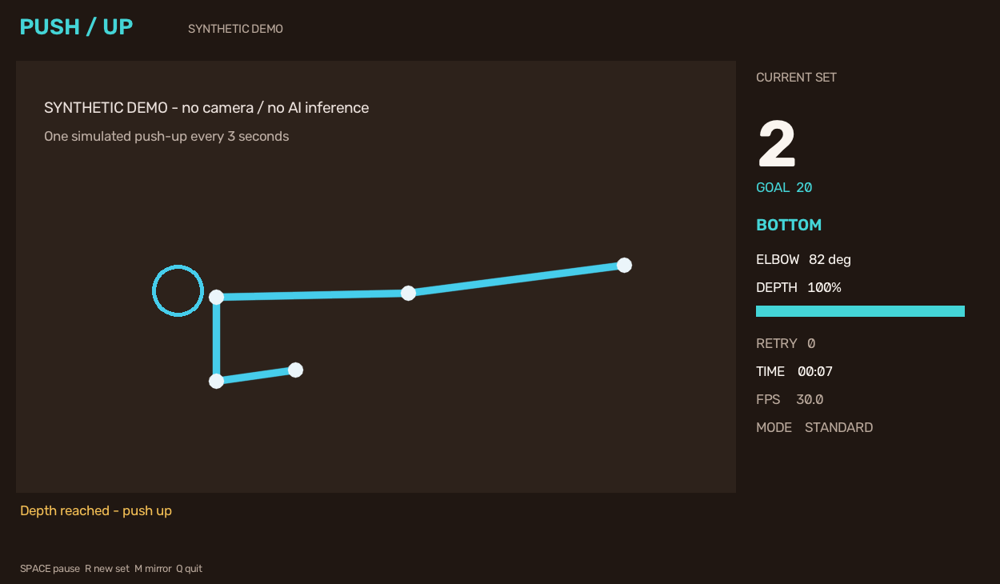

# Push-up Count

[](https://github.com/OagengKunene/Push-up-count/actions/workflows/tests.yml)


A webcam program that counts push-ups live using **OpenCV** and **Google MediaPipe Pose Landmarker**. It follows the visible arm and body, checks a complete top → bottom → top movement, and displays the rep count, elbow angle, depth progress and positioning feedback.



*The screenshot is a synthetic demonstration of the interface, not a webcam accuracy benchmark.*

## What it does

- Tracks a 33-landmark pose locally on your computer using MediaPipe's current Tasks API.
- Counts complete reps with angle smoothing, separate up/down thresholds, a stable-position hold and timing checks.
- Checks body alignment, leg position, camera framing and landmark confidence before counting.
- Supports standard push-ups and knee push-ups, with automatic or manually selected tracking side.
- Draws a skeleton, phase indicator, elbow angle, depth bar, rep goal and performance statistics.
- Offers pause/resume, new-set reset, mirror control and optional rep sounds.
- Saves per-attempt CSV logs and a JSON workout summary, including totals across sets.
- Accepts a webcam or local video. Annotated video recording is optional and must be requested.
- Includes a camera-free synthetic demo, diagnostics, regression tests and GitHub Actions checks.

## Start on Windows

1. Install **64-bit Python 3.11–3.14** from [python.org](https://www.python.org/downloads/), if needed. Python 3.14 is supported by this project; there is no requirement to install 3.12 specifically.
2. Choose **Code → Download ZIP** on this repository, then **extract the whole ZIP** to a normal folder.
3. Double-click **`start_windows.bat`** inside the extracted folder.

The launcher creates a private `.venv` environment and installs dependencies. The first real-camera run also downloads Google's approximately 5.5 MiB pose model and verifies its SHA-256 checksum. Later launches reuse the installed dependencies and cached model. Keep an internet connection for the initial setup.

In Windows Camera privacy settings, enable camera access and **Let desktop apps access your camera**. Close Teams, Zoom or other programs using the webcam if the camera cannot open.

To check your Python installation in PowerShell or CMD:

```powershell
py -3 --version
```

To try the interface without a webcam, run this from the project folder:

```powershell
start_windows.bat --demo
```

To use another webcam:

```powershell
start_windows.bat --camera 1
```

## Camera placement and first rep

Place the camera **to your side**, roughly level with your torso, and keep it steady and level. Make sure your visible shoulder, elbow, wrist, hip, knee and ankle fit inside the frame with some border space. For knee push-ups, the visible knee replaces the ankle as the support point.

Use good lighting, wear clothing that contrasts with the background, and exercise with one person in view. Begin in a straight-arm plank and hold it briefly until the panel says **TOP**. Lower until the panel says **BOTTOM**, then push up to straight arms. The count increases on the return to the top.

If the counter cannot see a usable pose, it displays positioning feedback. Reposition before changing angle thresholds.

| Key | Action |
| --- | --- |
| Space | Pause / resume; an unfinished rep is discarded |
| R | Start a new set at zero; earlier logged sets remain in the workout totals |
| M | Mirror / unmirror the camera view; restart the current movement |
| Q or Esc | Quit and save the workout summary |

## Install manually

Supported targets are Windows x86-64, Linux x86-64 (glibc 2.28+) and Apple Silicon macOS, with Python 3.11–3.14. The pinned MediaPipe release does not publish Intel macOS or Linux ARM wheels. A desktop session is required for the preview window.

```bash
git clone https://github.com/OagengKunene/Push-up-count.git
cd Push-up-count
python -m venv .venv
```

Activate the environment:

```powershell
# Windows PowerShell
.venv\Scripts\Activate.ps1
```

```bash
# Linux / macOS
source .venv/bin/activate
```

Then install and run:

```bash
python -m pip install --upgrade pip
python -m pip install -r requirements.txt
python app.py
```

Alternatively use `python -m pushup_counter` or the installed `pushup-counter` command. On Linux/macOS, `sh start_unix.sh` performs the same automatic setup as the Windows launcher.

On Debian/Ubuntu, MediaPipe/OpenCV may require native libraries:

```bash
sudo apt-get update
sudo apt-get install -y libegl1 libgles2 libgl1 libglib2.0-0
```

Install only one OpenCV distribution in this environment. This project uses `opencv-contrib-python`, which is also required by MediaPipe. Installing `opencv-python` or a headless OpenCV distribution alongside it can cause conflicting `cv2` files.

## Useful commands

Run these inside the installed environment, or pass the same options to `start_windows.bat`.

```bash
# Live counting with a goal and optional rep sound
python app.py --goal 20 --sound

# Knee push-ups
python app.py --variant knee

# Track a particular side; side names are the pose model's anatomical labels
python app.py --side left --no-mirror

# Analyze a local video; retain the whole body in frame
python app.py --video workout.mp4

# Save an annotated video explicitly; choose a filename that does not already exist
python app.py --video workout.mp4 --output-video counted.mp4

# Process a video without displaying a window
python app.py --video workout.mp4 --headless

# Diagnostics; the second command briefly opens the webcam
python app.py --check
python app.py --check-camera --camera 0

# Download/cache the verified model before going offline
python app.py --download-model
python app.py --offline

# Use an explicitly supplied copy of the official Lite v1 model
python app.py --model models/pose_landmarker_lite.task --offline

# Disable workout logs
python app.py --no-log

# Deterministic synthetic run: expected 4 reps in 12 seconds
python app.py --demo --headless --demo-seconds 12 --no-log
```

Use `python app.py --help` for every option. A goal changes the display; it does not automatically stop the workout. Headless webcam runs require `--max-frames N`; prerecorded video runs stop at the end of the file.

### Thresholds

| Setting | Default | Meaning |
| --- | --- | --- |
| `--up-angle` | 160° | Minimum elbow angle at the top |
| `--down-angle` | 95° | Maximum elbow angle at sufficient depth |
| `--min-body-angle` | 155° | Minimum shoulder–hip–support and standard-mode leg alignment |
| Stable hold | 0.12 s | Consecutive time required at a top/bottom threshold |
| Minimum rep time | 0.6 s | Minimum time from leaving the top zone to confirming the finish |
| Maximum rep time | 15 s | Discard movements that time out |
| Tracking timeout | 0.65 s | Discard an unfinished rep after a longer pose/frame gap |
| Smoothing factor | 0.45 | Exponential smoothing of the elbow angle |
| Maximum body tilt | 40° | Reject predominantly upright body positions |

The extra thresholds live in `pushup_counter/config.py` and are validated at startup. For example, `python app.py --up-angle 155 --down-angle 100` adjusts the range to your camera view. The down angle must remain below the up angle with enough separation for hysteresis.

## How counting works

1. OpenCV reads a frame and converts it from BGR to RGB for inference.
2. MediaPipe's Lite pose model estimates landmarks. The program selects a sufficiently visible side and retains it while usable.
3. Geometry uses **pixel coordinates**, correcting for image aspect ratio before measuring angles. Standard mode checks the shoulder–hip–ankle body line and hip–knee–ankle leg line. Knee mode uses the shoulder–hip–knee body line.
4. A temporal state machine follows **FIND TOP → TOP → LOWERING → BOTTOM → RISING → TOP**. Separate thresholds, hysteresis and hold times reduce jitter-driven transitions.
5. A rep is accepted only after a sufficiently deep movement returns to the top within the time limits. Completed shallow or too-fast attempts are logged as retries.

Short pose dropouts freeze progress and clear threshold holds. Long tracking gaps, side changes, form failures, mirror changes and pauses discard the unfinished movement and require a new top position. These discarded movements are not included in the retry count; that number refers to completed shallow or too-fast attempts.

The angle and depth percentage are **2D pose-based estimates**. A 100% depth bar means the configured elbow threshold was reached, not that a physical distance was measured. Occlusion, loose clothing, camera perspective and lighting affect results. The program is intended for a single person with a side-on camera; it does not measure chest-to-floor distance, force or fitness calories.

## Saved workouts and privacy

By default, `workouts/` contains a uniquely named `*_reps.csv` and `*_summary.json` for each run. The CSV records set number, rep number, timestamp, duration, minimum elbow angle, acceptance and reason. The summary records accepted reps across all sets, completed retries, mean accepted-rep duration and the configured thresholds. The timestamp is seconds from the camera session start or the position in an input/demo video. Duration is measured between movement-state thresholds.

Logs are flushed after each completed attempt. A normal quit or Ctrl+C also writes the final summary. Demo logs are explicitly labelled `synthetic demo`. Webcam elapsed time includes pauses; prerecorded/demo elapsed time follows the input timeline.

Inference runs locally. The app does not upload webcam frames or workout records and does not need an API key or account. It contacts Google only when it needs to download the model. It does not save camera video unless you pass `--output-video`. Logs, cached models, environments and personal recordings are excluded from Git.

## Troubleshooting

| Symptom | What to try |
| --- | --- |
| Camera will not open | Close other camera apps, enable desktop camera permissions, try `--camera 1` and `--check-camera` |
| Count stays at zero | Use a level side view with your whole visible side in frame; hold the top briefly before starting |
| Repeated body alignment feedback | Keep the body line straight; choose `--variant knee` for knee push-ups |
| Model download fails | Check the connection and run `--download-model`; for offline use supply the verified official Lite model with `--model PATH --offline` |
| `No matching distribution` | Use 64-bit Python 3.11–3.14 on a supported OS/architecture, then upgrade pip |
| `DLL load failed` on Windows | Install Microsoft's current [Visual C++ v14 Redistributable](https://learn.microsoft.com/en-us/cpp/windows/latest-supported-vc-redist) for your architecture |
| `libGLESv2.so.2` / `libEGL.so.1` missing | Install the Linux native libraries listed above |
| No display / OpenCV window error | Use a local desktop session, or `--headless` with a video/demo |
| PowerShell blocks activation | Run `start_windows.bat`, or call `.venv\Scripts\python.exe app.py` directly |
| Python changed after initial setup | Use a fresh extracted project folder so its virtual environment uses the new interpreter |

## Development and verification

```bash
python -m pip install -e ".[dev]"
python -m pytest -q
python -m ruff check .
python -m ruff format --check .
python scripts/smoke_model.py
```

The regression suite covers complete and partial reps, initial bottom positions, jitter, timing, bad form, missing tracking, side changes, pause/reset, aspect-ratio geometry, cropping, model integrity, log totals and CLI validation. The smoke script downloads/verifies the actual model and performs inference on three blank frames. It does not need a webcam.

GitHub Actions runs lint, regression tests, a synthetic demo and the real-model smoke check on Linux and Windows with Python 3.11 and 3.14. These are software checks; a live webcam check is still needed on your computer. See [the validation record](docs/VALIDATION.md) for checks performed during development and a short camera acceptance procedure.

| Path | Purpose |
| --- | --- |
| `app.py` / `pushup_counter/app.py` | Entry point, CLI and processing loop |
| `pushup_counter/counter.py` | Camera-independent temporal counting engine |
| `pushup_counter/pose.py` | MediaPipe Tasks integration and side/body checks |
| `pushup_counter/geometry.py` | Pixel-space angle calculations |
| `pushup_counter/model.py` | Versioned download, checksum and atomic cache |
| `pushup_counter/overlay.py` | Skeleton and dashboard |
| `pushup_counter/storage.py` | Per-attempt CSV and session JSON |
| `pushup_counter/demo.py` | Explicitly synthetic movement source |
| `tests/` | Behavioral regression tests |

## Model, references and licensing

This project's original code is MIT licensed. Dependencies and Google's model retain their own licenses and terms.

- [MediaPipe Pose Landmarker documentation](https://developers.google.com/edge/mediapipe/solutions/vision/pose_landmarker?tab=Python)
- [MediaPipe supported Python environments](https://developers.google.com/edge/mediapipe/solutions/setup_python)
- [MediaPipe 0.10.35 package](https://pypi.org/project/mediapipe/0.10.35/)
- [OpenCV Python package guidance](https://pypi.org/project/opencv-contrib-python/)
- [Official Lite float16 model, version 1](https://storage.googleapis.com/mediapipe-models/pose_landmarker/pose_landmarker_lite/float16/1/pose_landmarker_lite.task)
- [Google MediaPipe source and licensing](https://github.com/google-ai-edge/mediapipe)

Expected model SHA-256:

```text
59929e1d1ee95287735ddd833b19cf4ac46d29bc7afddbbf6753c459690d574a
```
